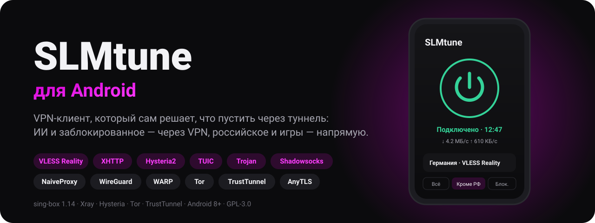
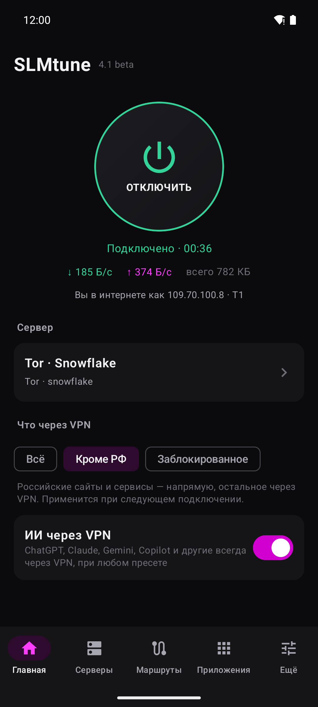
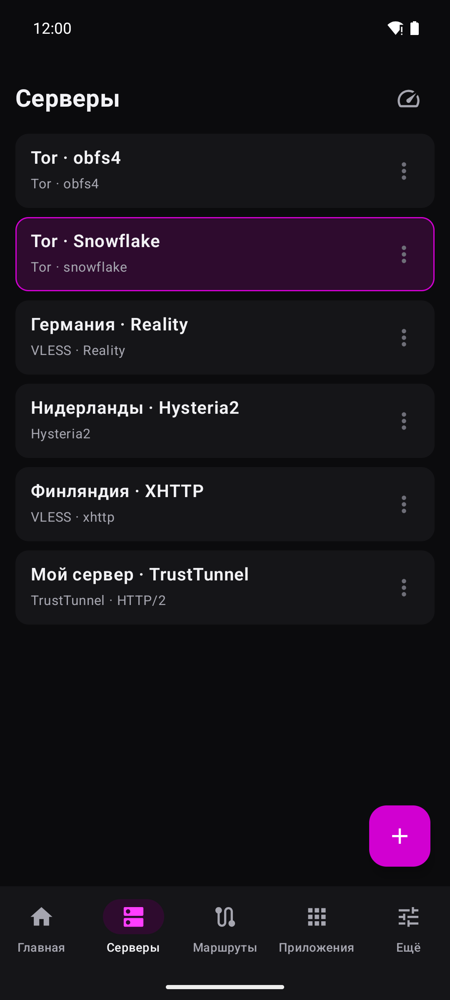
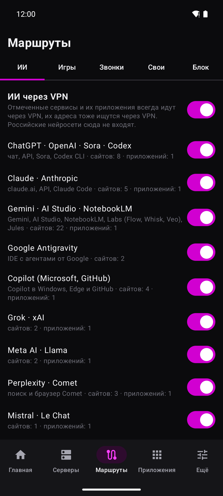
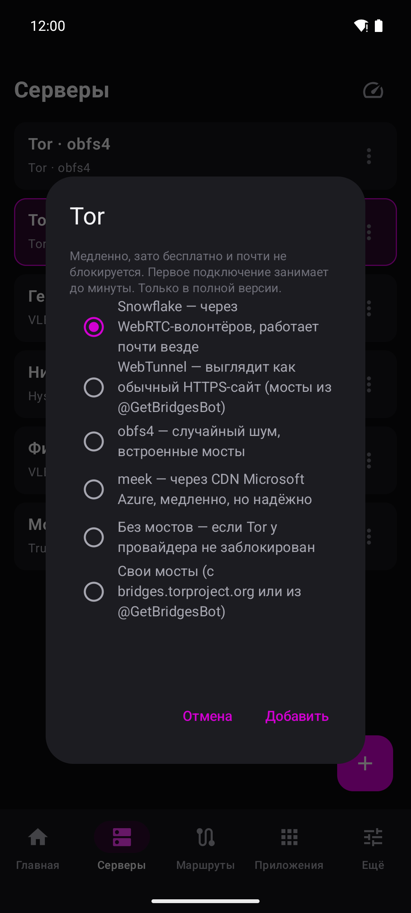
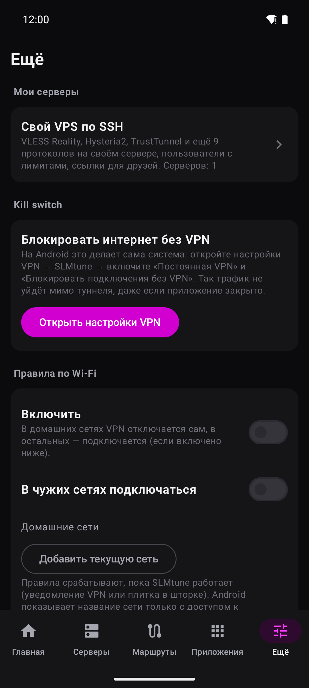
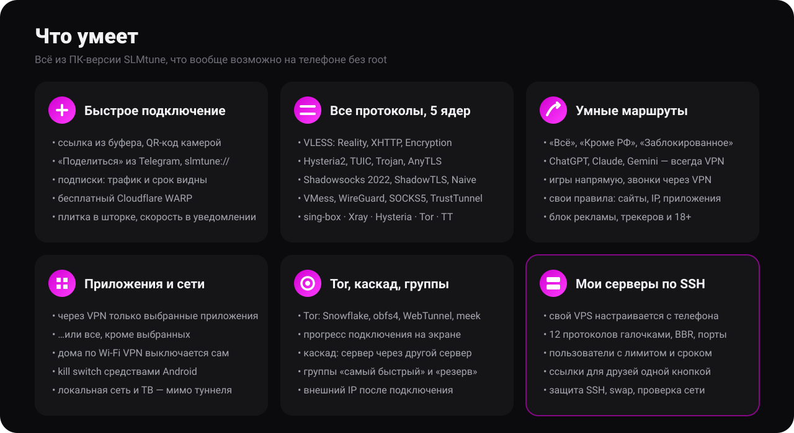
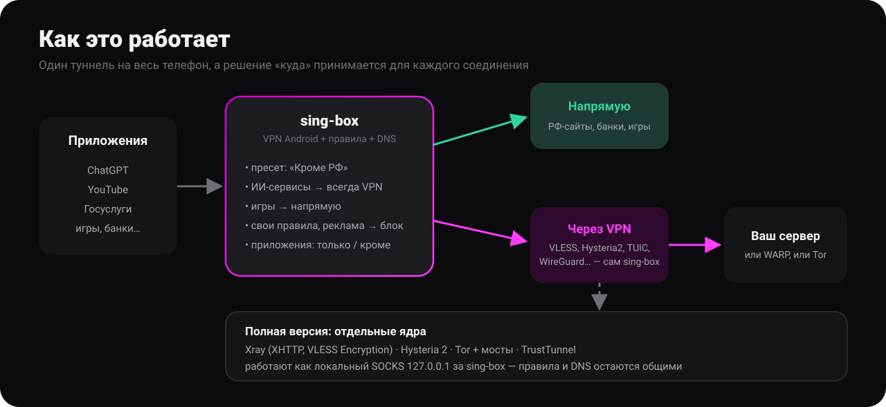

  

  
  
  
  
  
  

  <b>VPN-клиент, который сам решает, что пустить через туннель.</b> 
  ИИ и заблокированное — через VPN, российские сайты, банки и игры — напрямую. 
  Всё, что умеет SLMtune на ПК, теперь в телефоне: те же пресеты, те же списки, те же ядра.

---

## 📥 Скачать

| Ваш телефон | Полная — со всеми ядрами | Лёгкая — только sing-box |
|---|---|---|
| **Почти любой** (arm64) | [**full-arm64-v8a** · 67 МБ](https://github.com/SLM322/slmtune-android/releases/download/v4.1-beta/SLMtune-4.1-beta-full-arm64-v8a-release.apk) | [lite-arm64-v8a · 34 МБ](https://github.com/SLM322/slmtune-android/releases/download/v4.1-beta/SLMtune-4.1-beta-lite-arm64-v8a-release.apk) |
| Старый 32-битный | [full-armeabi-v7a · 52 МБ](https://github.com/SLM322/slmtune-android/releases/download/v4.1-beta/SLMtune-4.1-beta-full-armeabi-v7a-release.apk) | [lite-armeabi-v7a · 34 МБ](https://github.com/SLM322/slmtune-android/releases/download/v4.1-beta/SLMtune-4.1-beta-lite-armeabi-v7a-release.apk) |
| Не знаю | — | [lite-universal · 120 МБ](https://github.com/SLM322/slmtune-android/releases/download/v4.1-beta/SLMtune-4.1-beta-lite-universal-release.apk) |
| Эмулятор, Chromebook (x86_64) | [full-x86_64](https://github.com/SLM322/slmtune-android/releases/download/v4.1-beta/SLMtune-4.1-beta-full-x86_64-release.apk) | [lite-x86_64](https://github.com/SLM322/slmtune-android/releases/download/v4.1-beta/SLMtune-4.1-beta-lite-x86_64-release.apk) |

Все файлы и контрольные суммы — на странице [релиза](https://github.com/SLM322/slmtune-android/releases/tag/v4.1-beta). При установке Android попросит разрешить установку из этого источника — это нормально для APK не из Google Play.

  
  
  
  
  

---

  

## ✨ Возможности подробно

### 🚀 Подключение
- **Ссылки из буфера** — скопировали `vless://…` в Telegram, нажали «+» → «Из буфера», готово. Можно сразу много ссылок или base64-подписку.
- **QR-код** камерой, **«Поделиться»** из любого приложения, ссылки `slmtune://import?link=…` и `slmtune://subscribe?url=…`.
- **Подписки**: обновляются сами, показывают остаток трафика и дату окончания.
- **Cloudflare WARP** бесплатно — одной кнопкой, без регистрации.
- **Пинг** всех серверов, **плитка** в шторке, **скорость** в уведомлении, **внешний IP** после подключения — сразу видно, что VPN работает.

### 🔌 Протоколы и ядра
| Протокол | Ядро | Версия |
|---|---|---|
| VLESS (Reality, TLS, WebSocket, gRPC, HTTP/2, HTTPUpgrade), VMess, Trojan | sing-box | обе |
| Shadowsocks / 2022, ShadowTLS v3, NaiveProxy, AnyTLS, SOCKS5 | sing-box | обе |
| Hysteria2 (с прыжками по портам), Hysteria, TUIC v5 | sing-box | обе |
| WireGuard, Cloudflare WARP | sing-box | обе |
| **VLESS XHTTP**, **VLESS Encryption** (ML-KEM) | Xray | полная |
| Hysteria 2 через официальный клиент | Hysteria | полная |
| **Tor**: Snowflake, obfs4, WebTunnel, meek, свои мосты | Tor + lyrebird | полная |
| **TrustTunnel** (`tt://`) | TrustTunnel | полная, ARM64, эксперимент |

### 🧭 Маршруты — главное отличие от обычных VPN
- **Пресеты**: «Всё через VPN», «Кроме РФ» (российские сайты и сервисы напрямую), «Только заблокированное». Списки те же, что в ПК-версии, обновляются раз в сутки.
- **ИИ через VPN** — ChatGPT, Claude, Gemini, Copilot, Grok, Perplexity и ещё десятки сервисов вместе с их приложениями всегда идут через VPN, даже в пресете «Только заблокированное». Каждый сервис можно выключить.
- **Игры** — напрямую (ниже пинг) или игровой UDP через VPN, если провайдер его режет.
- **Звонки** — голос и видео Telegram, WhatsApp, Discord через VPN.
- **Свои правила** для сайтов, IP-сетей и приложений: через VPN, напрямую или блок.
- **Блокировка** рекламы, трекеров и сайтов 18+ внутри туннеля.

### 📱 Приложения и сети
- Через VPN **только выбранные** приложения — или **все, кроме** выбранных.
- **Правила по Wi-Fi**: в домашней сети VPN отключается сам, в чужих — включается.
- **Kill switch** штатными средствами Android («Постоянная VPN» + «Блокировать без VPN»).
- Локальная сеть, принтеры и трансляция на ТВ работают при включённом VPN.

### 🧅 Tor, каскад и группы
- **Tor с мостами** прямо в приложении: прогресс подключения на главном экране, понятная ошибка, если мосты не отвечают.
- **Каскад**: сервер через другой сервер, свой «через» у каждого или общий входной сервер.
- **Группы**: «самый быстрый» сам выбирает лучший сервер, «резерв» держится за рабочий.

### 🖥 Мои серверы — свой VPS прямо с телефона
- Вводите IP, пользователя и пароль из письма хостинга → сверяете отпечаток ключа → готово. Пароль нужен один раз: дальше вход по собственному ключу приложения.
- **12 протоколов галочками**: VLESS Reality, Hysteria2, Shadowsocks 2022, NaiveProxy, TrustTunnel, Trojan, TUIC, AnyTLS, VLESS WebSocket и gRPC, SOCKS5 для Telegram, ShadowTLS. Порты, файрвол, BBR и сертификаты Let's Encrypt — сами.
- **Пользователи** с лимитом трафика и сроком действия, учёт трафика на сервере, ссылки для друзей одной кнопкой, добавление в свой список серверов.
- **Инструменты**: обновить sing-box, защитить SSH (fail2ban, вход только по ключу), swap и синхронизация времени, автообновления, проверка скорости и блокировок ChatGPT/Claude/Netflix, журнал служб, перезагрузка.
- Скрипты сервера те же, что в Windows-версии SLMtune: сервер, настроенный с ПК, открывается и с телефона.

---

  

## 📦 Полная или лёгкая?

| | Полная (`full`) | Лёгкая (`lite`) |
|---|:---:|:---:|
| sing-box, все его протоколы, маршруты, WARP | ✅ | ✅ |
| «Мои серверы» по SSH | ✅ | ✅ |
| Xray: VLESS XHTTP и Encryption | ✅ | — |
| Tor с мостами, официальный Hysteria 2 | ✅ | — |
| TrustTunnel | ✅ ARM64 | — |
| Размер (arm64) | ~67 МБ | ~34 МБ |

Если ваш сервер выдал обычную ссылку `vless://…reality…`, `hysteria2://` или подписку — хватит лёгкой. Если в ссылке `type=xhttp`, `encryption=mlkem…`, `tt://` или нужен Tor — берите полную.

## ❓ Частые вопросы

<b>Какой файл скачать?</b>

Почти всем — `full-arm64-v8a` (или `lite-arm64-v8a`). Для телефонов старше ~2017 года, которые не открывают arm64, — `armeabi-v7a`. Сомневаетесь — `lite-universal`, он работает везде.

<b>Почему после подключения само приложение «мимо VPN»?</b>

Отдельные ядра (Xray, Tor, Hysteria, TrustTunnel) работают как процессы приложения и не могут пометить свои сокеты для Android. Чтобы их трафик не зациклился в туннель, приложение на это время исключается из VPN. Проверка внешнего IP при этом идёт через sing-box, так что вы видите настоящий адрес выхода.

<b>Tor подключается долго или не подключается</b>

Первое подключение — до минуты. Если мосты одного типа не отвечают, попробуйте другой: Snowflake обычно работает почти везде; свежие obfs4 и WebTunnel выдаёт бот @GetBridgesBot.

<b>Как проверить, что APK настоящий?</b>

Официальные APK подписаны сертификатом `CN=SLMtune`, SHA-256:
`7f9d733f881b061774757b13730f00b11a541b2fb046990aa34fa73b6686b8c9`.
Обновления ставятся поверх установленного приложения только с этой подписью. Суммы файлов — в `SHA256SUMS.txt` в релизе.

<b>Чего нет по сравнению с ПК-версией?</b>

Zapret — на Android без root невозможен. Официального клиента NaiveProxy под Android нет, но NaiveProxy работает через sing-box.

## 💜 Поддержать проект

SLMtune бесплатный и с открытым кодом. Если он вам помогает — поддержите разработку:

  

<a href="https://www.donationalerts.com/r/slm322">donationalerts.com/r/slm322</a> · новости и обсуждение — <a href="https://t.me/SLMtune">t.me/SLMtune</a>

## 📜 Лицензия

GNU GPL версии 3 (файл [`LICENSE`](LICENSE)), как и ядро [sing-box](https://github.com/SagerNet/sing-box), которое входит в приложение. Код службы VPN частично взят из [sing-box-for-android](https://github.com/SagerNet/sing-box-for-android) (GPL-3.0); такие файлы помечены в начале.

Полная версия содержит неизменённые сборки: [Xray-core](https://github.com/XTLS/Xray-core) (MPL-2.0), [Hysteria](https://github.com/apernet/hysteria) (MIT), Tor и lyrebird из [Tor Expert Bundle](https://gitlab.torproject.org/tpo/core/tor) (Tor собран под GPL-3.0), [клиент TrustTunnel](https://github.com/TrustTunnel/TrustTunnelClient) (Apache-2.0). SSH — [sshj](https://github.com/hierynomus/sshj) (Apache-2.0) и [Bouncy Castle](https://www.bouncycastle.org/) (MIT).

## 🛠 Сборка из исходников

Как собрать самому

Проще всего — GitHub Actions: [`.github/workflows/build.yml`](.github/workflows/build.yml) собирает всё с нуля при каждом пуше (ядро sing-box, отдельные ядра со сверкой SHA-256, тесты, обе версии APK). Готовые файлы — в артефактах запуска.

Локально нужны JDK 17 и 21, Android SDK (platform 37.1, build-tools 37), NDK r29, Go 1.25+, Python 3.

1. **Отдельные ядра** (для полной версии): `python3 tools/fetch_cores.py` скачивает последние релизы, сверяет SHA-256 с опубликованными проектами и кладёт их в `app/src/full/jniLibs` и `app/src/full/assets`.
2. **Ядро sing-box**: исходники `v1.14.4`, затем `go run ./cmd/internal/build_libbox -target android` с `JAVA_HOME` на OpenJDK 17. Готовый `libbox.aar` положить в `app/libs/`.
3. **Приложение**: `./gradlew assembleFullRelease assembleLiteRelease`. APK — в `app/build/outputs/apk/<full|lite>/release/`.
4. **Проверки**: `./gradlew testFullDebugUnitTest`. С `SLM_SINGBOX`, указывающим на sing-box, каждый сгенерированный конфиг проверяется самим sing-box; рядом лежащий `xray` проверяет конфиги Xray; `SLM_SSH_TEST="порт|authorized_keys|ключ_сервера.pub"` включает живую проверку SSH.
5. **Скрипты сервера** (`app/src/main/assets/server`) генерируются из `ServerSetup.cs` Windows-версии скриптом `tools/gen_server_scripts.py`, чтобы обе программы настраивали сервер одинаково.

**Подпись.** Без `release.jks` и `keystore.properties` (их нет в репозитории) сборка подписывается отладочным ключом. В GitHub Actions релизный ключ берётся из секретов `KEYSTORE_BASE64`, `KEYSTORE_PASSWORD`, `KEY_ALIAS`, `KEY_PASSWORD`; только такая сборка по тегу `v*` публикуется как релиз.

